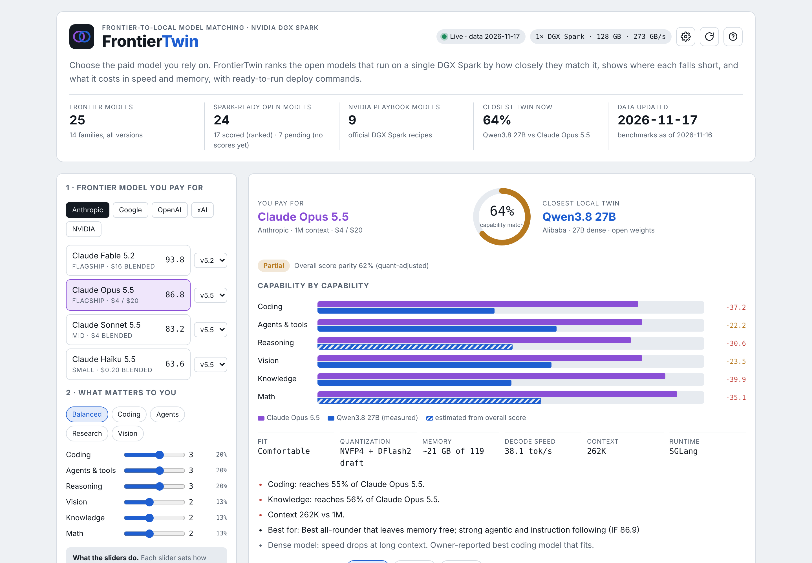

# FrontierTwin

Frontier-to-local model matching for NVIDIA DGX Spark.

Developer: **Subramoniam AB (SAB)** · Version 1.0.5



Pick the paid model you rely on (Claude, GPT, Gemini, Grok, Nemotron, any version). FrontierTwin ranks the open models that run on **one DGX Spark** (128 GB, ~119 GB usable, 273 GB/s) by how closely they match it, shows the gap per capability, speed and memory, marks models with an **official NVIDIA DGX Spark playbook**, and gives copy-ready deploy commands.

Self-contained: Python 3.8+ standard library only. No pip install, database, CDN or internet needed to run.

**Step-by-step guide for every OS: [HOW_TO_RUN.md](HOW_TO_RUN.md)**

---

## Features

| Area | What you get |
|---|---|
| Target picker | 25 frontier models in 14 families, version dropdown per family (e.g. Opus 5.5 / 5 / 4.8) |
| Priorities | Presets (Balanced, Coding, Agents, Research, Vision) and six weight sliders with live share % and explanation |
| Constraints | Vision, NVIDIA playbook only, tight fits, min context, min speed, local version and family |
| Closest twin | Match %, verdict, capability bars, gaps, quant, memory, tok/s, context, runtime, other versions |
| Deploy | vLLM, SGLang, TRT-LLM, llama.cpp, Ollama, NIM and Open WebUI commands; ✓ = NVIDIA playbook |
| Ranking | All Spark-ready models against the selected target |
| Match matrix | Every frontier model × every local model, best twin per row |
| Pending | Models that run on a Spark but have no published scores yet (excluded from ranking) |
| Header tools | Settings (port), Refresh data, Help (`?` key) |
| Live data | Page re-reads `data/models.json` every 60 s and on tab focus |

## Quick start

| System | Start |
|---|---|
| DGX OS / Ubuntu / Linux | `./start.sh` |
| macOS | `./start.sh` |
| Windows | double-click `start.bat` |
| Docker | `docker compose up -d --build` |
| No server | double-click `index.html` (offline, no auto-refresh) |

Open `http://localhost:8080`, or `http://<spark-ip>:8080` from another machine.

**Port busy?**

- At start-up the script asks for another port; Enter accepts the suggested free one. Unattended runs pick the next free port.
- While running: **gear icon → Settings** → enter a port → **Check port** → **Apply and move**. The server moves, saves the port to `config.json` and the page opens the new address.
- Or start on a fixed port: `./start.sh --port 9000` (Windows `start.bat --port 9000`).

### Run as a service (DGX OS / Ubuntu)

```bash
sudo cp -r frontiertwin /opt/ && cd /opt/frontiertwin
sed -i "s/REPLACE_WITH_YOUR_USER/$USER/" frontiertwin.service
sudo cp frontiertwin.service /etc/systemd/system/
sudo systemctl daemon-reload && sudo systemctl enable --now frontiertwin
```

Windows (start at logon): `schtasks /create /tn "FrontierTwin" /sc onlogon /tr "py -3 C:\frontiertwin\ft.py serve"`

## Command summary

Windows: replace `python3` with `py -3`.

| Command | Purpose |
|---|---|
| `python3 ft.py serve [--host H] [--port P]` | Start the dashboard (asks for another port if busy) |
| `python3 ft.py refresh [--catalog URL] [--discover]` | Update data; open pages pick it up within 60 s |
| `python3 ft.py add FILE.json` | Add or correct models (kept across upgrades) |
| `python3 ft.py check-update [--manifest URL]` | Check for a new release |
| `python3 ft.py upgrade --from ZIP\|URL [--replace-data]` | Install a release (automatic backup) |
| `python3 ft.py rollback [BACKUP]` | Restore a backup |
| `python3 ft.py version` | Installed version |

## Refreshing data

| How | What happens |
|---|---|
| Automatic | Open pages re-read data every 60 s and on tab focus |
| Refresh icon (header) | Server rebuilds data (merges `catalog_url` if set) and the page reloads it |
| `python3 ft.py refresh` | Rebuild and apply `data/overrides.json` |
| `python3 ft.py refresh --catalog URL` | Merge a newer shared catalog |
| `python3 ft.py refresh --discover` | Add new Spark-sized models from Hugging Face as pending |
| Scheduled | cron / systemd timer / Task Scheduler (see below) |

```bash
# Ubuntu / DGX OS / macOS (crontab -e): Mondays 10:17
17 10 * * 1 cd /opt/frontiertwin && /usr/bin/python3 ft.py refresh --discover >> refresh.log 2>&1
```

```powershell
# Windows
schtasks /create /tn "FrontierTwin Refresh" /sc weekly /d MON /st 10:17 /tr "py -3 C:\frontiertwin\ft.py refresh --discover"
```

## Configuration (`config.json`)

| Key | Default | Meaning |
|---|---|---|
| `host` | `0.0.0.0` | `127.0.0.1` = this machine only |
| `port` | `8080` | Web port (also set from Settings in the page) |
| `catalog_url` | `""` | Default source for `refresh --catalog` |
| `update_manifest_url` | `""` | Default source for `check-update` |
| `discover_limit` | `60` | Hugging Face models inspected by `--discover` |
| `discover_max_age_days` | `120` | Ignore older models |
| `allow_web_refresh` | `true` | Refresh icon may rebuild data on the server |
| `web_refresh_discover` | `false` | Refresh icon also runs Hugging Face discovery |

## Adding or correcting models

```json
{
  "id": "my-qwen-finetune", "kind": "local", "name": "My Qwen Finetune",
  "vendor": "Me", "family": "Qwen 27B dense", "version": "3.8-ft1",
  "paramsTotal": 27, "paramsActive": 27, "contextK": 128, "vision": false,
  "scores": { "overall": 55, "coding": 50, "agentic": 60 },
  "spark": { "fit": "native", "quant": "NVFP4", "memGB": 21, "tps": { "decode": 36 },
             "tpsSource": "measured", "runtime": "vLLM" },
  "deploy": { "hf": "me/my-qwen-finetune", "verified": ["hf"] },
  "playbooks": [{ "name": "vLLM", "url": "https://build.nvidia.com/spark/vllm" }],
  "sources": ["https://..."]
}
```

`python3 ft.py add my-model.json` stores it in `data/overrides.json` (kept across upgrades).

| `kind` | Meaning |
|---|---|
| `frontier` | Paid target model |
| `local` | Runs on a Spark and has capability scores; ranked |
| `pending` | Runs on a Spark, no published capability scores yet; listed with speed, memory and deploy commands but left out of match %, ranking and matrix until scores are added |

Scores use BenchLM's 0–100 categories: overall, coding, agentic, reasoning, multimodal, knowledge, math. Models with the same `family` appear as selectable versions.

## Upgrading

```bash
python3 ft.py check-update                          # needs update_manifest_url
python3 ft.py upgrade --from frontiertwin-1.1.0.zip  # or an https:// URL
python3 ft.py rollback                              # restore previous version
```

`upgrade` backs up the install to `backups/`, installs the new files, keeps `config.json`, `data/overrides.json` and a newer `models.json`, then re-applies overrides. Restart afterwards (`sudo systemctl restart frontiertwin` or `docker compose up -d --build`).

Release manifest (host anywhere):

```json
{ "version": "1.1.0", "url": "https://example.com/frontiertwin-1.1.0.zip", "notes": "What changed" }
```

## How matching works

1. **Capability ratio:** local score ÷ frontier score per capability, capped at 100%.
2. **Weights:** Match % = Σ (weight × ratio) ÷ Σ weights; sliders set each weight 0–5.
3. **Estimates:** missing local capabilities are estimated from the overall score (hatched bars).
4. **Quantization:** 4-bit ×0.98, 3-bit ×0.93, 2-bit ×0.88; NVFP4, MXFP4, FP8 = native.
5. **Vision gate:** a text-only model scores 0 on Vision against a vision model.
6. **Fit and speed:** "fits" = weights + ~8 GB cache under 119 GB; "est." speed from active parameters and 273 GB/s.

| Verdict | Match % |
|---|---|
| Near-equivalent | ≥ 90 |
| Close | 75–90 |
| Partial | 60–75 |
| Distant | < 60 |

## Deploy commands

Follow NVIDIA's DGX Spark playbooks (https://build.nvidia.com/spark, https://github.com/NVIDIA/dgx-spark-playbooks): vLLM `nvcr.io/nvidia/vllm:26.05.post1-py3`, TRT-LLM `1.3.0rc13`, SGLang `latest-cu130`. ✓ on a runtime tab = a playbook covers that model on that runtime. Handles marked "verify on Hugging Face" are unconfirmed; check before pulling.

| Runtime | Port |
|---|---|
| vLLM | 8000 |
| SGLang | 30000 |
| TRT-LLM | 8355 |
| llama.cpp | 30000 |
| Ollama | 11434 |
| NIM | 8000 |
| Open WebUI | 3000 / 8080 |

## Files

```
frontiertwin/
  index.html            dashboard
  ft.py                 control script
  start.sh / start.bat  launchers
  config.json           settings
  data/models.json      catalog (polled by the page)
  data/models.js        catalog for offline file mode
  data/overrides.json   your edits (kept across upgrades)
  docs/screenshot.png   README image
  Dockerfile, docker-compose.yml, frontiertwin.service
  HOW_TO_RUN.md, CHANGELOG.md, VERSION
```

## Data sources (16–17 Nov 2026)

BenchLM leaderboard and model pages, Artificial Analysis Intelligence Index v5.0.1, GPUwerk / OpenClawDC / PyShine DGX Spark speed measurements, NVIDIA DGX Spark playbooks. Scores are public benchmarks, not your workload; validate a twin on your own tasks before switching.

## Developer

Subramoniam AB (SAB)
